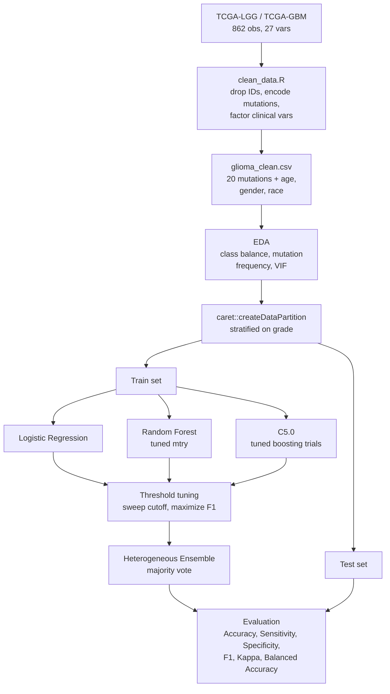

# Ensemble-Model-for-Glioma-Tumor-Classification-using-TCGA-Data

## Project Overview
This project develops and evaluates machine learning models for classifying glioma tumors into Glioblastoma Multiforme (GBM) and Lower Grade Glioma (LGG) using genomic and clinical data from The Cancer Genome Atlas (TCGA).

The analysis follows the CRISP-DM framework and compares three classification approaches:

Logistic Regression
Random Forest
C5.0 Decision Tree
Heterogeneous Ensemble combining the three models

The goal is to determine which modeling approach provides the most reliable classification of glioma tumor grade based on mutation profiles and clinical characteristics.

## Motivation
Gliomas are a heterogeneous group of brain tumors with substantial differences in tumor grade and clinical behavior. Distinguishing between GBM and LGG is important because tumor grade is associated with disease characteristics and patient management.

Genomic mutation patterns and clinical characteristics can provide valuable information for tumor classification. This project explores whether machine learning models can use these features to accurately distinguish GBM from LGG.

A key motivation for this analysis is to compare different machine learning strategies and determine whether combining models through an ensemble approach improves predictive performance.

## Objective
1. Prepare and clean the TCGA glioma dataset for machine learning.
2. Identify and remove non-informative or identifier variables.
3. Transform categorical variables into an appropriate format for modeling.
4. Examine feature relationships and potential multicollinearity.
5. Train and tune Logistic Regression, Random Forest, and C5.0 models.
6. Use cross-validation to evaluate model stability and generalization.
7. Tune classification thresholds to optimize F1-score.
8. Combine the three models into a heterogeneous ensemble.
9. Compare model performance using accuracy, sensitivity, specificity, F1-score, Kappa, and balanced accuracy.
10. Identify the most robust model for GBM/LGG classification.

## Workflow

## Technologies and Packages

The analysis was conducted in R using packages including:

ggplot2 — data visualization
car — multicollinearity/VIF analysis
caret — stratified data splitting and model evaluation
randomForest — Random Forest modeling
C50 — C5.0 classification and boosting

These packages were used for data preparation, exploratory analysis, model development, tuning, and evaluation.

## Dataset

The dataset comes from the UCI Machine Learning Repository's TCGA-LGG and TCGA-GBM dataset.

The dataset contains:

862 observations
27 original variables
20 gene mutation features, including genes such as IDH1, TP53, and ATRX
Clinical and demographic variables such as age, gender, and race
Grade as the target variable, with two classes: GBM, LGG
